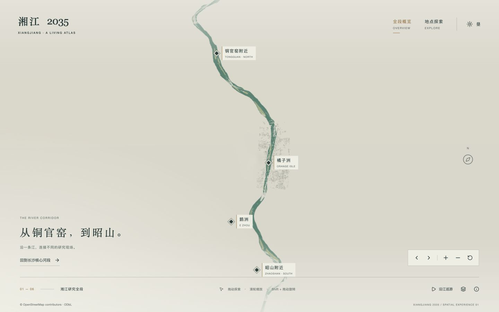
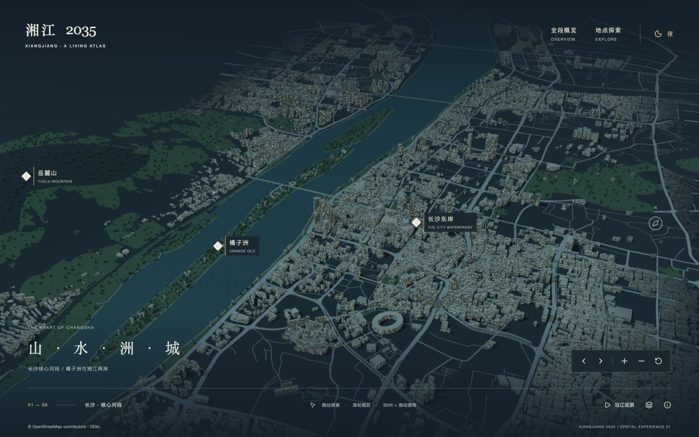
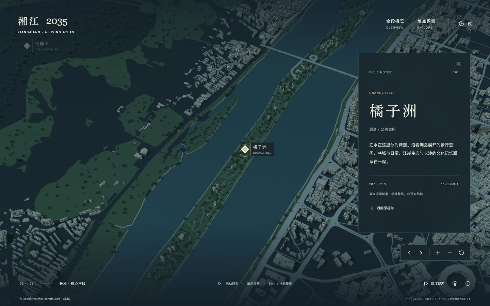

# 湘江 2035 对齐自查 · 2026-10-21

结论：现有版本完成了基础功能，但未完成原任务要求的外围连续城市、全段覆盖和接近 Masar 的美术层级。上一轮“完成”的表述过宽，应改为“可运行的场景原型”。以下是本轮重新截图和代码核查的结果；本轮没有修改渲染实现。

## 证据与限制

本轮重新操作本地生产页面，检查日间、全段、铜官窑局部、夜景、橘子洲聚焦。截图在 `screenshots/audit-2026-10-21/`。参考实站、官方案例、官方图片在本地浏览器均出现 ERR_CONNECTION_CLOSED，不能声称本轮完成双方重新实操对照。外部网页检索能读取官方案例的项目说明，但文字不替代视觉证据。对参考目标的描述沿用用户明确要求：核心高细节，外围保留空间并弱化，最远处自然融合；此前参考研究另见 reference-analysis.md，旧图不作为本轮重新验证证据。

官方案例公开说明项目制作了 WebGL 城市场景并支持日夜切换：https://immersive-g.com/projects/masar-destination/ 。本轮不推定其内部 Shader、资产格式或相机实现。

## 建筑到底怎么来的

链路：OSM 官方 API → 下载原始地图 JSON → osmtogeojson → 本地 xiangjiang.geojson → Three.js ExtrudeGeometry。

- API 提供的是地理要素及标签，不是现成长沙三维模型。
- 浏览器只加载本地 `/data/xiangjiang.geojson`，没有实时加载在线建筑模型/3D Tiles。
- 16,004 个建筑要素生成16,086个多边形体量，其中1,041个有可用 height/levels 标签，约6.47%；其余约93.53%估高。
- 高度缺失时按 building 用途与 OSM ID 取模估计；当前注释称“基于面积”并不准确，面积仅参与远景筛选。所有高度另乘1.65视觉倍率。
- 普通建筑立面窗格为程序化 Shader。没有逐栋手工精模、真实外立面、屋顶/退台或长沙地标专属模型。
- 树木是代码实例化的低面数几何，在部分公园/林地/洲岛中铺设，不是实测单木；桥墩也为程序化示意。

代码：`scene.ts:64–81`，数据转换：`scripts/prepare-scene-data.mjs`。

## 空缺的四层原因

1. **取数范围不足（首要原因）**：核心采集框112.930–113.005E、28.130–28.280N，约7.36km东西宽、16.70km南北跨度。建筑数据中15,998/16,004个位于此纬度范围，南侧5个、北侧1个只是边界要素，不能视作沿江覆盖。研究端点南北跨度约52.43km，实际河道长度更长。
2. **地物生成还有硬边界**：建筑 x 限制±7.5km，z限制−10.4至7.8km；道路筛选在原点±9km附近；公园筛选在±6.5/7km附近。硬范围比某些已取数据更大，不能把所有当前空缺都归因于裁切；但即使未来补进全段数据，也仍会被现有条件丢弃。
3. **远景切换整组关闭**：相机距离220单位时关闭全部树木；250–350单位切换建筑层；350后关闭 city 组，而道路、公园与建筑同在这个组。并非单个物体按屏幕尺寸平滑降细节。
4. **外围融合过强且方向错误**：建筑按轴对齐矩形计算空间淡出，最大95%混向雾色；不沿真实弯曲河道区分重点带与上下文带。配合距离雾和 CSS 奶白遮罩，已有建筑也会被过早冲淡。

应采用“核心细节带 → 持续存在的外围白模/低对比道路与植被 → 最远景雾”，不是把空白伪装成弱化。白模也需要可信空间数据。

## 逐项未对齐清单

| 优先级 | 问题 | 本轮依据 | 修正验收方向 |
|---|---|---|---|
| P0 | 铜官窑至昭山无连续沿岸数据 | 步骤2/3；建筑空间统计 | 全段先具备真实低细节城市/道路/地形上下文 |
| P0 | 两岸往陆地方向稀疏、断层 | 步骤1；数据框与硬过滤 | 扩大覆盖，实区分采集缺口与真实开敞空间 |
| P0 | 外围弱化变成消失 | 步骤2；engine.ts:73 / materials.ts:21 | 保留体量与阴影、低对比呈现；移除整组开关 |
| P1 | 核心和外围缺少明确资产层级 | 步骤1；所有建筑相同挤出机制 | 核心定制/立面细节，外围简化但连续 |
| P1 | 日间整体灰绿、米黄、发闷 | 步骤1；THEMES及CSS渐变 | 按参考目标校准中性白/浅灰底，核心材质与绿化独立，不全局染绿 |
| P1 | 夜间窗光碎而均匀，主体不突出 | 步骤4；materials.ts:24–33 | 按区域设计亮度；重点建筑/道路灯光，压低外围纹理 |
| P1 | 城市高差与天际线缺乏可靠性 | 高度估计比例及1.65倍率 | 引入实际高度，估算不塑造虚假高层地标 |
| P1 | 山体是函数示意，城市未随地形统一落地 | scene.ts terrainHeight/建筑统一y | 真实DEM和一致的道路/建筑高程基面 |
| P1 | 桥梁只有线带与规则桥墩 | scene.ts:83–89/106 | 重要桥梁增加独立形体与桥头衔接 |
| P1 | 选中地点只强调marker和小圆环 | 步骤5；engine.ts:95–97 | 轻度强调真实洲岛/区域/模型，其余三维上下文适度弱化 |
| P1 | 全段地点在聚焦后marker消失 | 步骤3；show要求distance>170，端点聚焦130 | 选中marker豁免远景可见性条件 |
| P1 | 缺少真实反射、岸线细部 | 步骤1/4；水面仅法线扰动和高光 | 增加克制反射、岸线接触层次，不扩大波浪 |
| P2 | LOD并非真正几何简化 | scene.ts:81重复挤出同轮廓，只删小建筑且高度×0.65 | 分块与几何简化保留空间密度，不靠压低高度 |
| P2 | 巡游为三段独立起停 | engine.ts:92 / camera.ts:56 | 改为连续速度路径，重点停留按叙事安排 |
| P2 | UI与目标气质偏离 | 步骤1/4/5 | 标签常显、底栏文字和按钮组较多；收敛控件与面板，不照搬品牌 |
| P2 | 对比度/触摸目标仍需测量 | 小字号、浅底浅线的截图及CSS | 实测对比度和触摸面积；未宣称WCAG合规 |

其他数据差距：四条不完整支流已过滤，尚未补齐；鹅洲仍未校准；CGCS2000未接入；建筑min_height虽保留但渲染未使用，建筑与building:part也未系统处理父子重叠。这些属于地理与模型质量缺口，不能靠换色解决。

## 本轮逐步截图

### 1. 核心日间：功能正常，视觉层级不达标
河道可识别，但大量空地、灰绿整体色与相似窗纹使城市层次不足。核心与外围没有稳定清晰的材质分级。外围白模连续性未达到目标。

### 2. 全段概览：入口正常，覆盖不达标
有河道、标记与少量核心城市，中远段沿岸几乎空白。不能称“全段城市场景完成”。

### 3. 铜官窑聚焦：相机正常，场景缺失
除江水与洲岛色块，缺少道路、建筑、植被及地形；选中marker也因距离规则隐藏。信息面板不应替代场域本身。

### 4. 夜间：主题切换正常，美术未达标
窗光大面积均匀散布，缺少核心地标与铺装照明组织；道路亮线较机械，山体发黑。不是简单把白天变暗就能对齐目标。

### 5. 橘子洲聚焦：信息交互正常，三维强调不足
程序只改变marker权重并增加小圆环，没有把真实洲岛作为选中区域处理。面板与场景遮挡关系也需继续调整。

## 建议修正顺序

第一轮优先完成“全段真实上下文数据 + 更宽的两岸外围 + 按河道距离分层”，再以同镜头对照调整中性白灰的日间材料和核心/外围明暗。随后做真实地形、重要地标与桥梁，再精修夜景、窗纹、连续镜头和UI。

只补API、只改颜色或只加雾，都不足以修复当前问题。数据覆盖和场景分层需要一起改；每一步以实际画面验收，而非以编译成功验收。
