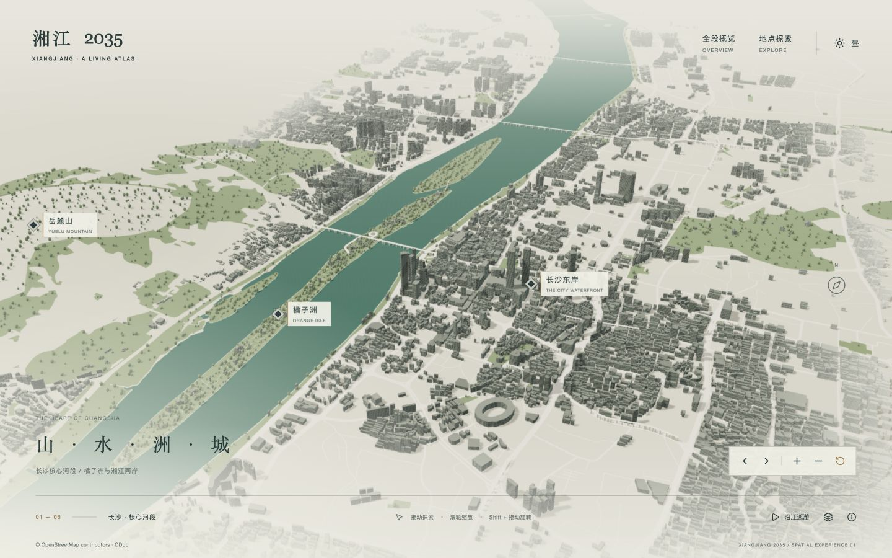
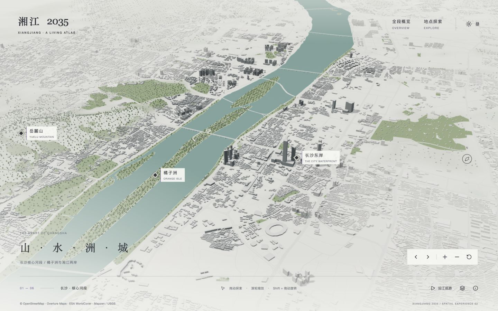
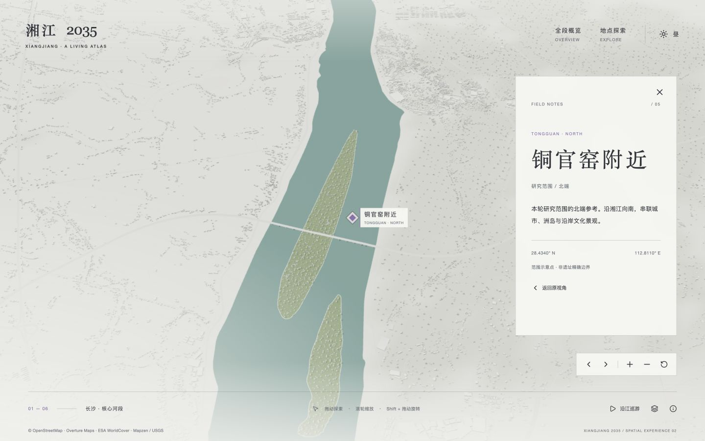

# 湘江场景第二轮重构 · 2026-10-21

本轮重点是补齐研究全段的空间背景、修正“外围弱化等于删除”的实现，并重建灰白材质、地形和聚焦层次。预览仍为 http://127.0.0.1:3001/experience，页脚版本为 `SPATIAL EXPERIENCE 02`。修改前检查点为 Git 标签 `before-context-rebuild`（73f29b3）。

## 建筑来源与表示方式

| 层次 | 数据 | 本轮表示 |
|---|---|---|
| 原长沙核心区 | OpenStreetMap 建筑轮廓、height/levels | 按原轮廓挤出；有标签的高度使用标签值，取消全局1.65倍率；未知高度按用途估算 |
| 更宽两岸、铜官窑至昭山 | Overture Maps 2026-09-23.1，建筑上游含 OpenStreetMap 与 East Asian Buildings（doi:10.5281/zenodo.8174931） | 依据真实轮廓计算方向和包围体，作为简化白模；不是逐栋精模，也不是实时三维API |
| 树木 | OSM 绿地与 Overture 中的 ESA WorldCover 2021 林地覆盖 | 在覆盖范围内布置实例化树冠；不是实测单木 |
| 地形 | Mapzen / Tilezen Terrain Tiles，USGS SRTM/GMTED2010 | 解码高程，生成连续地形；河岸周边压平，非测绘级高程表达 |

233/233 个建筑瓦片、233/233 个道路瓦片、67/67 个基础覆盖瓦片下载成功。建筑瓦片边缘同ID多边形先合并，再生成包围体。旧核心采集矩形内不叠加背景模型，避免与现有 OSM 建筑重复。

新增背景建筑数据142,157个：北段61,597、南段46,128、核心纬度带向陆地延伸34,432；其中290个有高度/层数，其他默认12m。运行时排除落入江面的体量后，场景总计158,242个建筑体量，已知高度计数1,331。已知高度比例低，不能把天际线视作实测结果。新增道路30,085段；新增林地覆盖来自2,597个源多边形，栅格化为320×512的地形覆盖掩码。场景树木共41,578棵示意实例。

## 已修正

- 删除建筑、道路、树木的核心矩形生成限制，以及拉远镜头时关闭整组模型的逻辑。
- 核心建筑按距真实河道的距离渐变到白模背景；外围保留体量与地面关系。背景建筑和树木按地理分块做视锥裁剪。
- 日间改为中性灰白底、青灰水面、淡紫交互色，减弱米黄色覆盖；窗格做屏幕尺度抗闪烁，夜间保留窗光和暗部体积。
- 建筑、道路与林地使用同一公开高程基面；修正粗网格在河面露出的三角块。
- 阴影范围随镜头目标移动，使北段和南段也获得接触阴影；相机近平面随距离调整，修正全段缩远时的水面深度闪斑。
- 橘子洲选中时按真实洲岛轮廓着色、描边。外围地点聚焦时增强附近背景建筑的灰度，选中标记不再因距离规则消失。
- 全段端点聚焦构图重新调整，昭山兼顾参考点与江面；连续巡游替代三段独立起停。
- 建筑 min_height 开始参与构建；恢复桥下示意支撑，不把它们称为实际桥梁模型。
- 页面增加 OSM、Overture、ESA WorldCover、Mapzen/USGS 来源入口，版本号区分前后。

## 验证与实际边界

2026-10-22 完成生产预览验收：3001 服务已重启并加载最新构建；全段水面未再出现此前的深度闪斑，昭山视图同时包含江面和参考点。390×844 窄屏的文档宽度与滚动宽度均为390，地点面板可读；验证了地点切换后的关闭按钮焦点、Esc返回和巡游停止按钮。浏览器未记录错误或警告。验收后恢复浏览器原尺寸，并保留日间核心区预览。移动端仅做浏览器尺寸模拟，未做真机性能验收。

类型检查、生产构建、17项测试通过；26项需要数据库的原有测试按原条件跳过。ESLint无错误，保留旧 prototype-html 中2条未使用变量警告。浏览器检查核心、北段、南段、全段、日夜、区域聚焦、返回、巡游中断和窄屏布局；截图见 `screenshots/rebuild-2026-10-21/`。开发预览约120fps，1440×900生产预览核心约71fps、北段约90fps；这是本机观察值，不是所有设备的性能承诺。

仍未达到参考成品的部分：核心地标和重要桥梁还没有专属精细模型；建筑外立面不是真实贴图；水面仍是法线扰动与光照高光，没有真实场景反射；背景白模是轮廓包围体，无法保留所有凹凸形状；公开源有覆盖与时效误差，未保证逐栋完整。鹅洲演示坐标与CGCS2000校准仍未解决。此次不能表述为“与 Masar 完全对齐”。

## 可复现流程

```sh
pnpm install
node scripts/prepare-terrain.mjs
node scripts/download-context.mjs buildings
node scripts/download-context.mjs base
node scripts/download-context.mjs transportation
node scripts/prepare-context.mjs
node scripts/prepare-environment.mjs
pnpm build
pnpm start --hostname 127.0.0.1 --port 3001
```

下载器失败时返回非零退出码，再运行会复用已完成瓦片。下载缓存不进入Git。正式运行只读取 `public/data/` 本地文件，不依赖在线地图服务或密钥。源数据记录见 `data/context/manifest.json`、`data/context/environment-manifest.json`、`data/terrain/manifest.json`。

来源：[Overture Buildings](https://docs.overturemaps.org/guides/buildings/)、[Overture发布目录](https://stac.overturemaps.org/2026-09-23.1/catalog.json)、[East Asian Buildings](https://doi.org/10.5281/zenodo.8174931)、[ESA WorldCover](https://esa-worldcover.org/en)、[Terrain Tiles](https://registry.opendata.aws/terrain-tiles/)、[地形来源说明](https://github.com/tilezen/joerd/blob/master/docs/attribution.md)。OSM与Overture派生数据按ODbL标注；ESA WorldCover采用CC BY 4.0，包含经WorldCover联盟处理的Copernicus Sentinel 2021数据。

## 前后对照

核心日间采用相同镜头预设与1440×900截图。北段新版缩近了焦距以改善阅读，因此北段不是严格同镜头对比。

修改前核心：


修改后核心：


修改前北段：


修改后北段：

