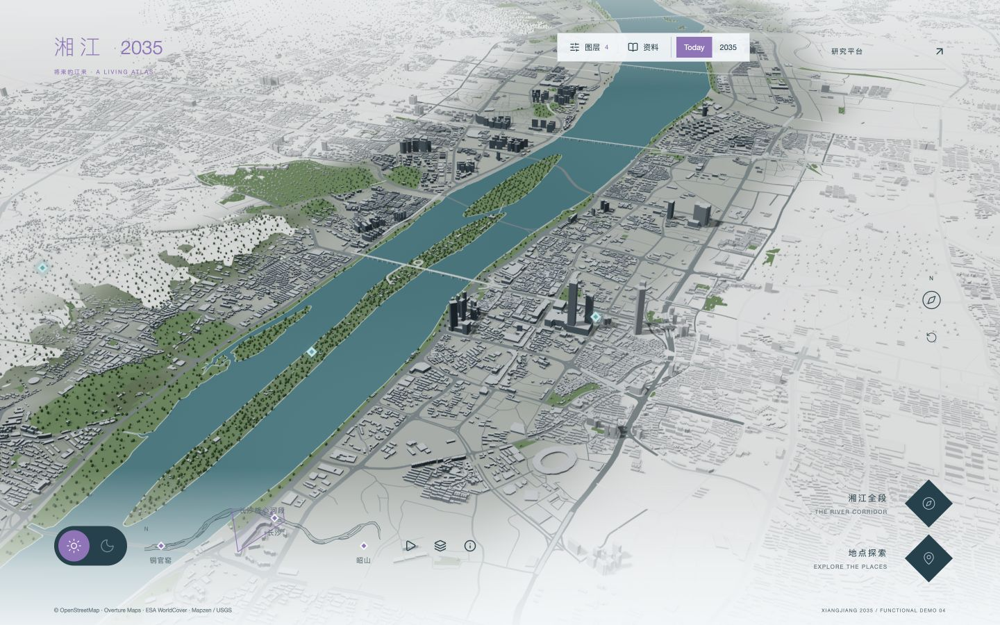
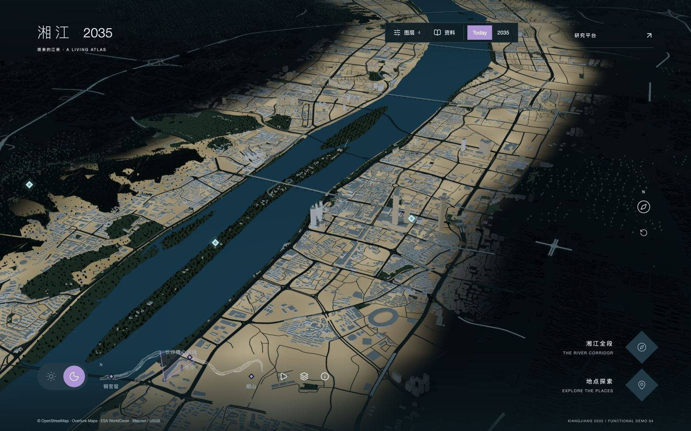

# 湘江生态文化与社会创新地图 · 演示指南

2026-10-22。地图名称：湘江 2035 / 将来的江来。

打开 http://127.0.0.1:3001/experience 。如果仍看到旧页面，刷新一次。停止服务或重启电脑后，按 README 重新运行 `pnpm build` 和 `pnpm start --hostname 127.0.0.1 --port 3001`。

## 建议演示路径

1. **地图探索**：开始探索 → 湘江全段 → 地点探索 → 鹅洲。预览显示标签、位置精度和简介，选择“进入地点详情”。页首“湘江 2035”或镜头重置返回长沙核心河段。
2. **地点研究**：已有研究 → 年份 2024 → 洲岛生活与生态走读 → 关联文献证据。可以打开原文，也可“在地图中查看”，然后点击地图中的资料标记回到研究。
3. **空间关系**：图层 → 开启生态与社会 → 点击“活动观察路线 · 演示”。打开的是明确标为待验证的 Conflict，两类对象同时高亮。查看关联文献、观察模板，再进入“低干扰的洲岛导览与维护服务”设计机会。
4. **未来方案**：从设计机会进入“洲岛轻行”方案 → 查看 2035 设计愿景。地图出现三个服务触点与一条连接路线；可隐藏/显示方案，或恢复 Today。Today 中所有未来对象均隐藏。

不用按顺序浏览：页首“资料”可直接进入研究、问题或方案；“2035”可直接打开鹅洲概念方案。五个地点详情栏目可随时切换。

## 地图与状态

- 六类图层：基础地理、生态、文化、社会、研究、设计方案。开关实际控制 Three.js 叠加对象及可点选标记。基础三维城市始终保留。
- 选择研究时自动开启相关图层；关闭详情、返回地图或切换地点保留已选图层。切换地点按地点过滤对象。当前只有鹅洲有完整研究与方案目录。
- 全段尺度隐藏细小标签，可通过图层列表定位对象。小地图继续展示真实河岸与视野范围。
- 拖动平移，右键或 Shift 拖动旋转，滚轮缩放；画布获得焦点后方向键旋转、Home 重置。Escape 依次关闭当前面板/详情/地点。
- 这些状态保留在当前浏览会话中，刷新后恢复默认状态；未增加登录、收藏或持久化偏好。

## 真实资料与演示资料

| 类型 | 内容 | 边界 |
|---|---|---|
| 地理来源 | 既有 OSM/Overture/WorldCover/高程数据；鹅洲轮廓来自本地 OSM 河道内环 | 建筑多数高度为估算，植被为范围内布置；不是精测城市模型 |
| 近似定位 | 鹅洲 112.9481, 28.0099，经洲岛轮廓内点校验 | 公开地名位置，非地籍边界；旧数据库 seed 不被覆盖 |
| 2018 公开资料 | 长沙理工大学社会实践调研活动报道及文献索引 | 历史活动报道，未导入完整研究报告或原始访谈 |
| 2024 公开资料 | 长沙晚报鹅洲走读及文献索引 | 地方认识材料，非本平台学生研究成果 |
| 2026 公开问题 | 生活污水配套设施短板报道及文献证据 | 当前整改进展未核验，无排口坐标、水样或污染范围 |
| 演示研究 | 2026 研究项目、研究活动计划、未采集观察模板 | 没有伪造现场观察值、访谈或测量结果 |
| 演示研究对象 | Knowledge Gap、Spatial Gap、Conflict、Insight、Design Opportunity | 目录资料缺口与人工假设，不由空间重叠自动推出结论 |
| 2035 概念 | Product-Service System，3 个触点、1 条连接路线 | 全部为示意位置与愿景，非预测、施工方案或成效承诺 |

目录共有 15 条研究/证据/问题/设计记录、10 个空间对象、2 个情景。2018、2024、2026 为可浏览年份，没有建立虚构的 2027/2028 届次。Proposal 类型支持产品、服务、产品服务系统、空间装置、信息交互；本轮实例为产品服务系统。

公开来源：

- [鹅洲公开地名坐标](https://fallingrain.com/world/CH/11/Ezhou.html)
- [OSM 河道关系 8727387](https://www.openstreetmap.org/relation/8727387)
- [长沙理工大学 2018 社会实践报道](https://www.csust.edu.cn/qjxy/info/1111/8138.htm)
- [长沙晚报 2024 鹅洲走读](https://xjzb.icswb.com/h/106002/20240618/875653.html)
- [政协融媒 2026 专题调研报道](https://zx.zxy.hunanzx.gov.cn/szxapp/1/193/content_1124300.html)

## 当前边界与下一步

当前目录通过独立 TypeScript 文件组织、以 ID 关联，新增信息不写入数据库。原研究平台的真实采集、数据库、团队权限和媒体接口保留，内部数据没有被直接公开。正式研究发布和真实课程资料接入应在下一阶段结合权限、作者、授权和审核机制实施。

优先下一步：导入一组获准公开的鹅洲真实研究与田野记录，替换演示内容；校准路线、触点和研究范围，再做服务原型现场测试。其他地点可复用相同类型和浏览组件逐步补充内容。

## 昼夜地块自查与改进

此前重点/外围地面白色接近，夜间地面自发光过弱，呈现“亮墙、暗地”。本轮只调整地面材质：日间重点区灰绿中性色与外围冷白区分；夜间重点地块增加暖色局部发光，并保留外围低亮度。没有重做模型、相机或整套视觉系统。

与参考仍有差距：目前是程序化地块受光表达，尚无参考网站逐栋窗光、路灯与广场照明构成的精细层次；UI 也以完成研究任务为优先。本轮不宣称视觉复刻完成。

