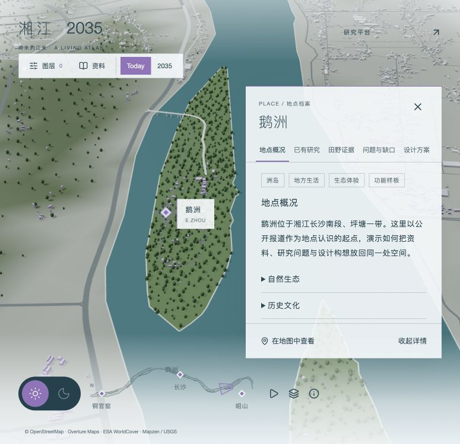
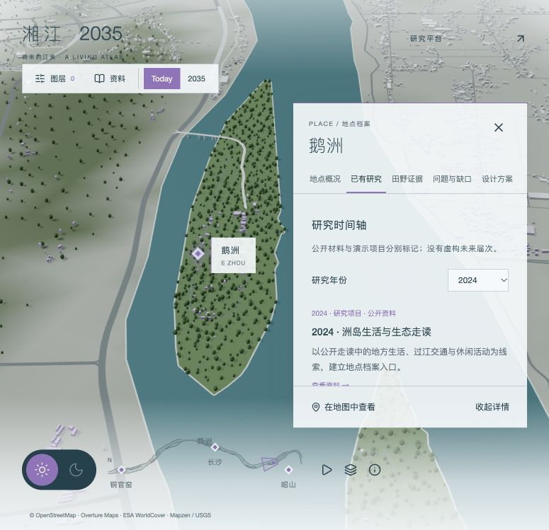
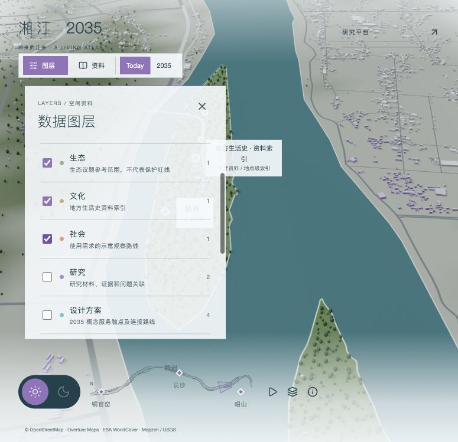
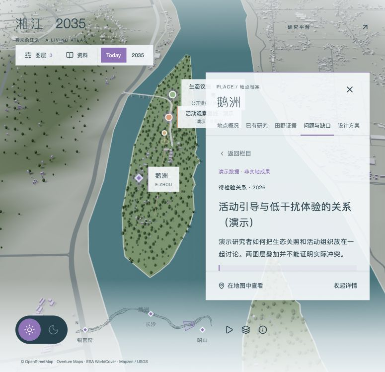
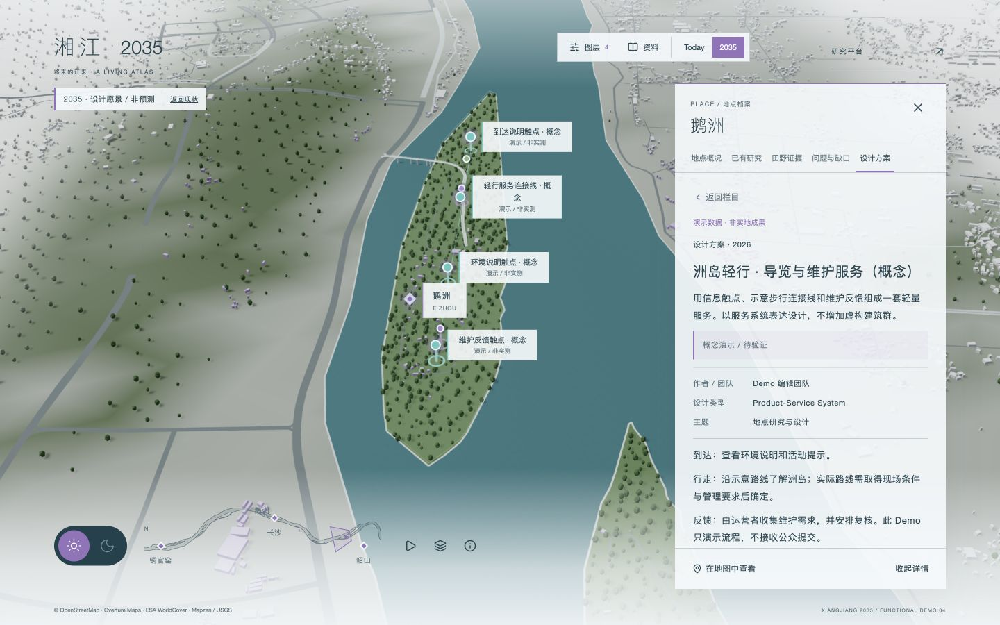
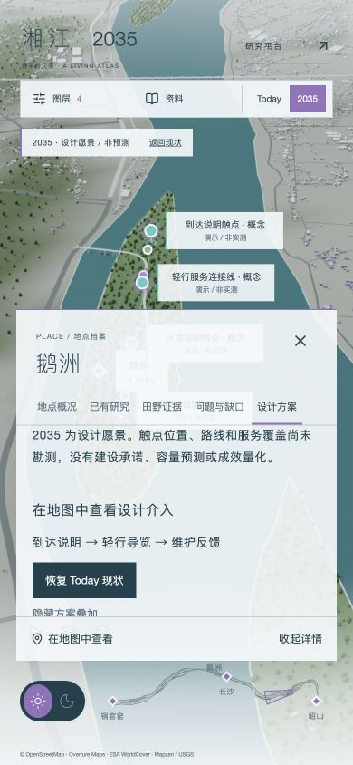

# 功能 Demo 状态与验收

更新：2026-10-22。工作分支 `feat/xiangjiang-functional-demo`；安全基线 `before-functional-demo-20261022` → `2fd7f95`。产品为“湘江生态文化与社会创新地图”，地图为“湘江 2035 / 将来的江来”。

Done 表示本轮功能样板完成并验证，不等于全量研究资料已建成。Partial 表示有可用部分但仍有明确缺口。Not Started 表示未开发。当前没有阻止 Demo 运行的 Blocked 项。

## 功能清单

| Sprint | 功能 | 状态 | 验收与边界 |
|---|---|---|---|
| A | 功能审计与安全检查点 | Done | 已操作旧生产页，审查代码、数据库、API，独立分支开发 |
| A | 核心/全段、地点聚焦/返回/重置 | Done | 复用现有相机，生产版完成全段→鹅洲→核心；Home 同步清除地点 |
| A | 平移、旋转、缩放及可中断动画 | Done | 复用既有控制，不重新编写相机系统 |
| A | Marker → Preview → Detail | Done | 鹅洲完整，其他五地点保留基础导航和档案入口 |
| A | 鹅洲概况、生态、文化、社会 | Done | 分栏目/折叠展开，公开来源与近似定位清晰标注 |
| B | 六类图层、过滤与对象查询 | Done | 开关实际作用于 Three.js；多选、点选、地点过滤通过 |
| B | Existing Research / Timeline | Done | 2018/2024/2026 年份列表和筛选；项目与活动均响应筛选 |
| B | 文献证据/田野模板 | Done | 双向跳转，原文可访问；无伪造观察值 |
| B | Knowledge Gap / Spatial Gap | Done | 独立类型、地点及证据关联；不把无标记等同于无研究 |
| B | 状态保留与尺度 | Done | 关闭面板/切换地点保留图层；全段缩小标签；刷新恢复默认 |
| C | Issue / Conflict / Insight | Done | 公开问题与演示假设分开；选择关系高亮相关对象与图层 |
| C | Design Opportunity | Done | 背景、研究关联、设计方向及 Proposal 链接可浏览 |
| C | Proposal | Done | 一项产品服务系统概念，3 触点与 1 线路；类型支持五类设计 |
| C | Today / 2035 | Done | 真实显示/隐藏未来对象、返回现状；明确“愿景 / 非预测” |
| C | 非线性入口 | Done | 资料索引可直接打开研究、问题、方案，2035 可直接进入样板 |
| C | 鹅洲完整演示路径 | Done | 研究→证据→待检验关系→机会→方案→2035→Today |
| 视觉补充 | 昼夜地块区分 | Done | 仅地面材质调整，截图 07/08；不代表整体视觉对标完成 |
| 数据建设 | 全部地点的真实研究资料 | Partial | 鹅洲 15 条目录记录包含公开资料及演示；其他地点未填满 |
| 数据建设 | 精确研究 GIS 与现场采集 | Partial | 真实洲岛轮廓及近似地点；概念触点/线路非实测 |
| 后续 | 正式研究发布/CMS/全量迁移 | Not Started | 本轮排除；现有私有数据库和权限保留 |
| 后续 | 真实提案、服务效果验证 | Not Started | 本轮为概念示例，无建设承诺或效果预测 |
| 后续 | AI/KJ/居民贡献/实时水质 | Not Started | 按任务明确排除 |

## Sprint A — 地图与地点

**完成**：功能审计、现有相机导航复核、地点预览到详情、鹅洲档案、来源与精度。将错误的未校准 seed 地点改为公开地名近似位置，并做洲岛内点验证；旧数据库坐标保持不变。

**复用**：Three.js 场景、自定义 CameraRig、PLACES、原导航/小地图、原研究平台 API 与数据库。相机参数仍集中于 `src/experience/config.ts`。

**主要文件**：`app/experience/experience.tsx`、`place-detail.tsx`、`atlas.module.css`、`src/atlas/places.ts`、`src/experience/config.ts`、`docs/functional-audit.md`；页面与平台入口命名更新。

**实际测试**：生产地址全段概览→鹅洲→预览→详情→展开内容→收起→返回核心；切到橘子洲后鹅洲对象消失、保留图层选择；画布 Home 清除选中地点并重置镜头。

**数据**：既有真实地理数据、OSM 洲岛轮廓、公开地名目录、2024 走读资料。没有代表图片时不使用虚构现场图片。

**尚未完成/问题**：其余地点只提供基本档案，研究栏目可为空；当前地点精度不等于测绘精度。后续优先确认鹅洲现场坐标、来源授权及真实资料。

## Sprint B — 地图与研究

**完成**：六类多选图层、空间对象列表与地图点选、研究按年份筛选、文献证据、两种 Research Gap、研究与空间双向进入。

**复用**：既有地图投影、地形采样和 DOM 标记位置更新；已有 ResearchSession/Place ID 映射保留。新增目录不访问或绕过私有研究权限。

**主要文件**：`src/atlas/{types,catalog,objects,ezhou-boundary}.ts`、`src/experience/overlays.ts`、`engine.ts`、`app/experience/layer-panel.tsx`、`place-detail.tsx`、`tests/atlas.test.ts`。

**实际测试**：选择 2024 仅显示该年研究；打开研究→文献证据→地图→点击空间标记回到研究。生态/社会多选后出现对应区域、路线、标记；关闭图层移除对应对象。切换地点更新对象且保留用户选择。开发测试发现部分示意点落到水面，已纠正到真实洲岛轮廓内，并增加点及路线顶点几何回归。

**数据**：2018、2024 公开资料与相应文献索引；2026 研究与活动计划/观察模板为明确标记的演示。Knowledge Gap、Spatial Gap 均描述当前目录的资料不足。

**尚未完成/问题**：年份列表不是完整历届课程档案；只读目录需要后续正式发布适配层。场景仍一次加载约 22.3 MB 未压缩地理 JSON，首次加载成本尚存在。

## Sprint C — 问题与方案

**完成**：公开 Issue、人工整理 Conflict、Insight、Design Opportunity、Proposal；Today/2035、方案隐藏/显示、资料直接入口与完整非强制演示路径。

**复用**：Sprint A/B 的统一地点/记录面板、图层机制、原场景渲染循环和导航。方案表达使用触点、路线与流程文字，无需新的建筑资产或后台。

**主要文件**：`src/atlas/catalog.ts`、`objects.ts`、`types.ts`；`app/experience/experience.tsx`、`place-detail.tsx`；`src/experience/engine.ts`、`overlays.ts`。

**实际测试**：社会对象→Conflict 同时高亮生态与社会对象；关联观察模板→关系→机会→Proposal；打开 2035 出现 4 个概念对象，隐藏方案后消失，再显示后恢复，Today 全部移除。当前地点及已选图层保留。另验证资料索引直接进入研究/方案，顶部 2035 可跨地点聚焦鹅洲。

**数据**：Issue 来自 2026 公开污水设施调研报道，现状进展未核验。活动引导 Conflict/Insight/Opportunity 与“洲岛轻行”Proposal 为演示假设；不宣称信息导览可以解决污水设施问题。

**尚未完成/问题**：只有一个概念方案；未采集真实访谈、未验证服务效果。中等宽度面板会遮挡部分长标记文字，可通过收起详情查看完整空间；移动端以底部面板浏览，长资料需滚动。下一步以真实研究替换演示，再校准服务触点和运营流程。

## 验证记录

| 检查 | 结果 |
|---|---|
| `pnpm typecheck` | 通过 |
| `pnpm build` | 通过，生产预览已重启至当前构建 |
| `pnpm lint` | 0 error；2 条原有 prototype-html 图片 warning |
| `pnpm test` | 27 passed，26 数据库集成测试 skipped；未把跳过测试视为通过 |
| 新增目录回归 | 7 项：ID/来源关联、鹅洲定位、示意几何、Today 排除未来、图层/地点过滤、对象关系、非虚构年份 |
| 浏览器 Console | 本轮生产操作后 error/warn 查询为空 |
| 本机 HTTP | `/experience` 及四个场景数据请求均 200；完成响应体读取 |
| 页面加载 | 生产版实际完成场景初始化，无加载错误；新增目录无外部网络依赖 |
| 响应式 | 1440×900、1280×720、390×844 开发视口及约 775×749 生产面板实测 |
| 状态与坐标 | 正向/返回、地点过滤、图层保留、Home、方案显隐验证；几何点在洲岛内 |
| 性能观察 | 本机生产流程运行中约 55–88 FPS，核心/全段因场景规模波动；不是设备性能保证 |

HTTP 检查是本机生产端点响应测试，不是完整 Network 瀑布分析。数据库集成、真实手机 GPU、弱网、跨浏览器与长时内存压力测试尚未执行。本轮没有更改数据库 schema、采集服务或权限规则。

## 真实与演示清单及下一步

完整来源、逐类数据边界、演示步骤、材质自查及后续优先级见 [功能 Demo 指南](functional-demo-guide.md)。下一阶段建议先获得一组可公开的真实鹅洲研究/田野资料，再接入正式发布流程；不优先扩展功能数量。
