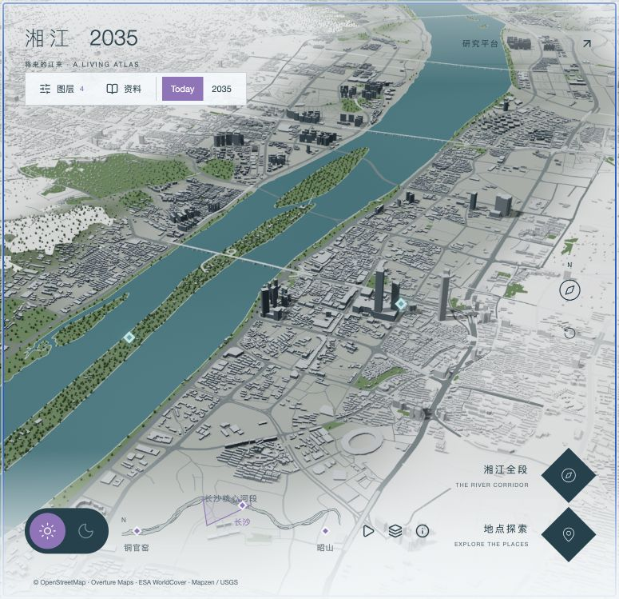

# Spatial Research Explorer · 开发前审计

2026-10-22。基线 `7579154`；标签 `before-spatial-explorer-20261022`；分支 `feat/spatial-research-explorer`。先读取现有代码和实际 3001 页面，再开始增量开发。

## 已有能力和复用方式

| 模块 | 现状 | 本轮处理 |
|---|---|---|
| 场景 | Three.js 0.186；OSM/Overture 宏观城市；无 Cesium | 继续 Three.js，局部场景独立生命周期，不加载整个城市数据 |
| 相机 | CameraRig：阻尼、平移、旋转、缩放、fly/cruise、取消、资源清理 | 添加可选局部边界与初始姿态配置，默认参数保持主地图行为 |
| 地点 | PLACES、鹅洲近似地名坐标；Preview/Detail 已可用 | 增加研究现场链接，返回带 place=ezhou 的原地图 |
| 研究 | atlas 类型/本地目录、15 条资料、六类宏观图层、证据关联 | 保留；局部研究场景用独立 Mock Dataset，避免与公开地理资料混用 |
| 标注 | 已有点、线、区域、DOM 跟随投影 | 复用投影模式；新增局部统一视觉配置、对象拾取、遮挡检测和避让 |
| UI | 深青、浅色文字、紫色强调；浮动工具、按需详情面板 | 延续视觉语言，模型占主要区域；五语义层与主题筛选 |
| 模型加载 | 宏观场景程序生成，无真实扫描模型加载器 | 程序化原型 + 资产接口；预留 GLB 替换，不引入第二引擎 |
| 路由 | Next App Router，/experience 和独立研究平台 | /experience/sites/ezhou 新增子路由 |
| 后端 | Drizzle/PostgreSQL、采集/媒体/团队权限 | 不新增数据库，不改变授权；本地 Mock 未来可接 API |

## 界面与问题证据

1. 主地图可操作，已有 Place / Research / Proposal 入口。修改前实际截图见下。紫框为视锥地面投影，倾斜视角下自然呈梯形；不符合用户要求的矩形定位框。改为目标平面上的旋转矩形示意，缩放随相机变化，全段时等比适配边界。
2. 默认 UI 和引擎均为日间。将 UI 状态、场景背景、首帧材质和光照共同改为夜间，避免先闪白后切暗。
3. 尚无局部研究现场、真实扫描资产、语义/空间形态独立编码和 Guided Research 控制器。本轮新建独立模块，不重写宏观地图。
4. 仅截图无法证明键盘可达性、深度遮挡和资源释放；这些将在实际操作与回归阶段检查。

## 参考检查范围

已打开 UNESCO 指定页面并捕获入口；入口提示继续即同意 Terms of Use，因此没有点击 Enter、没有声称完整操作其内部导览。仅观察到全屏场景背景、简洁顶部导航和单一进入动作。交互架构按用户提供的明确要求实现，不以未验证的参考内部行为作为事实。

## 实现职责

- Site / ScanAsset：地点关系、局部坐标与模型变换，Mock 标记。
- Site Scene / Loader：程序化场景、独立资源清理，未来替换资产。
- CameraRig：复用相机算法，局部边界由配置传入。
- Spatial Annotation Renderer：语义样式、点线面对象、遮挡/距离/避让。
- Research Store：统一实体 ID、双向证据与发现关联；自由和引导共用。
- Guided Controller：原子同步层、主题、选中对象、镜头、方案状态；暂停/恢复/退出。
- React 页面：主题/层开关、列表/详情、引导控制、返回宏观地点。
