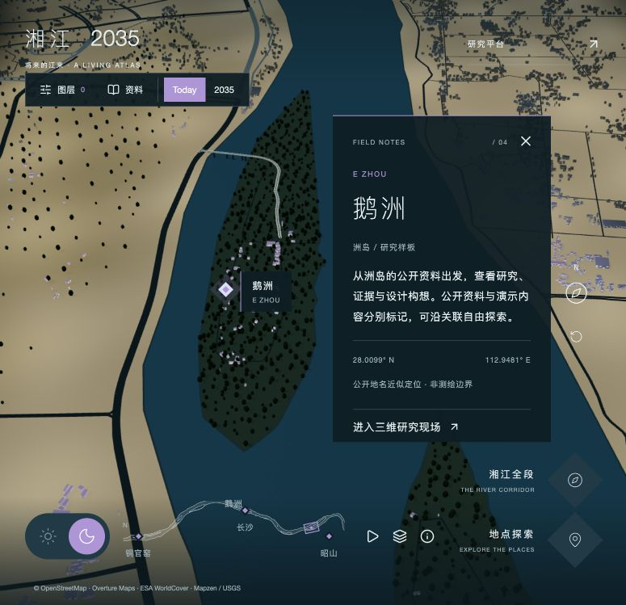
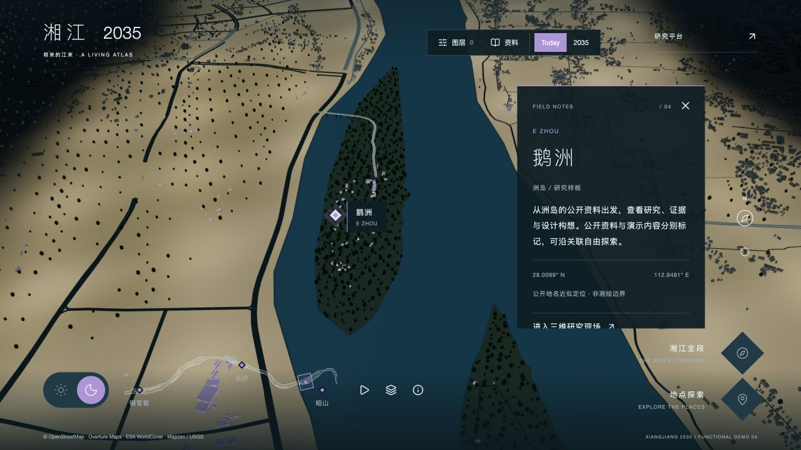
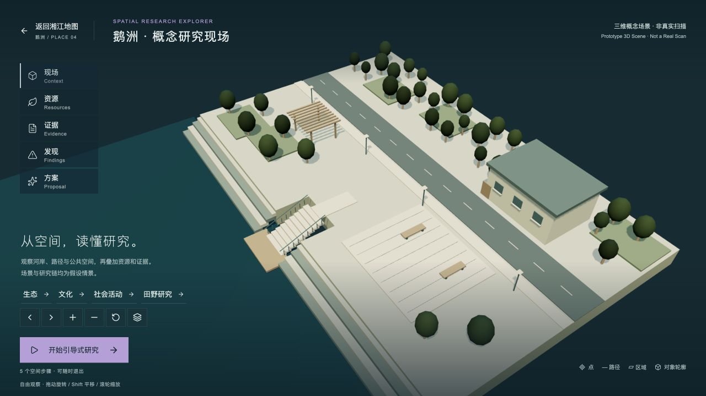
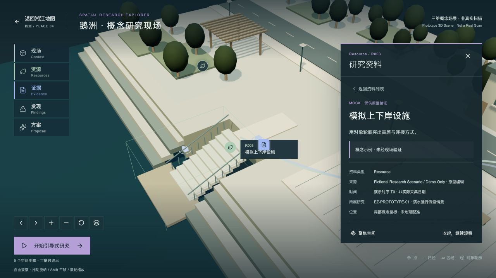
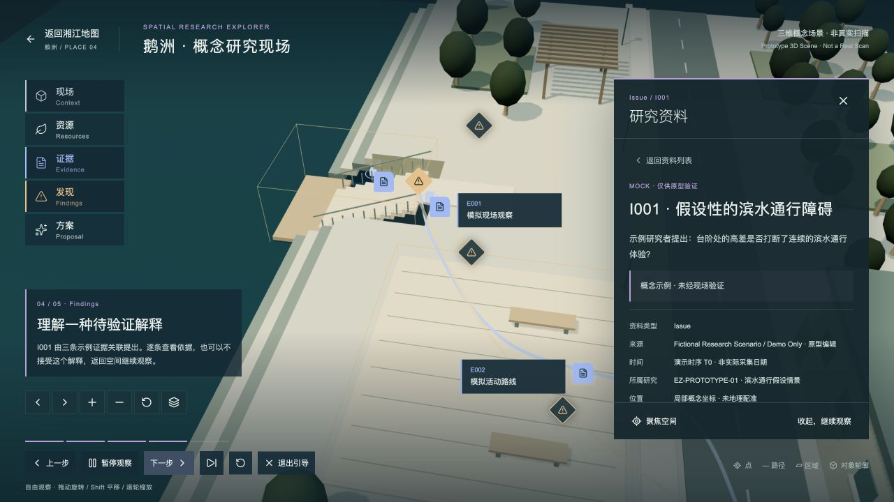
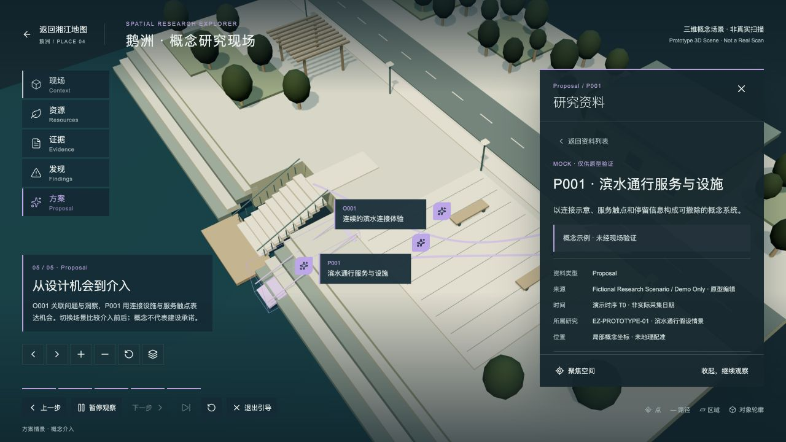
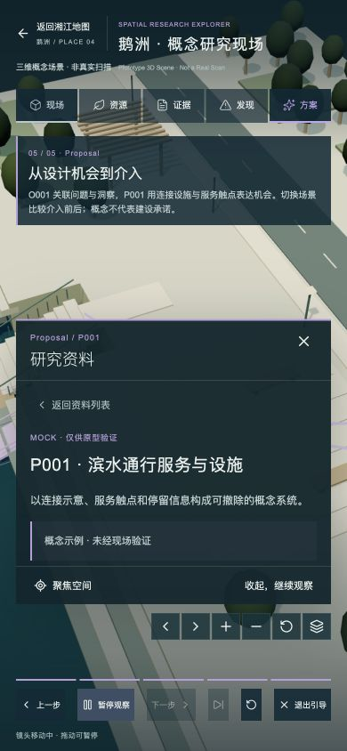
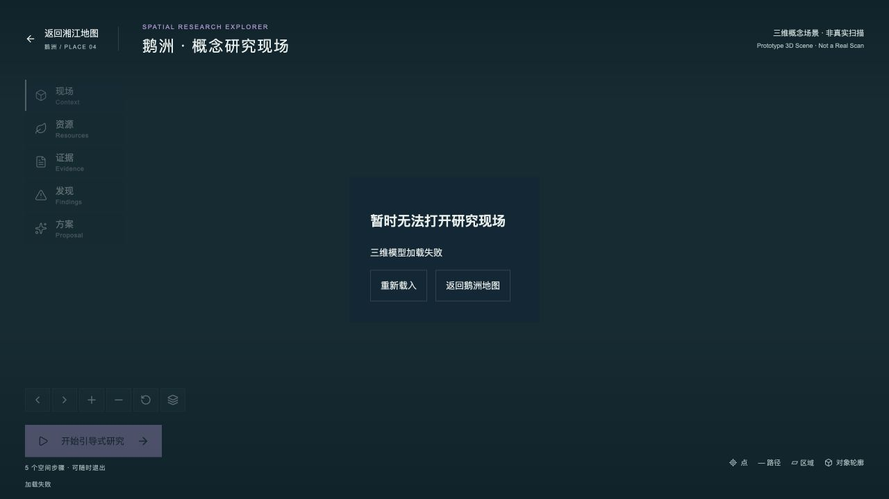

# Spatial Research Explorer V1.0 — 交付与状态

验收日期：2026-10-23（Asia/Shanghai）。开发分支 `feat/spatial-research-explorer`；修改前检查点 `before-spatial-explorer-20261022` / `7579154`。

## 入口与运行

- 主地图：http://127.0.0.1:3001/experience
- 概念研究现场：http://127.0.0.1:3001/experience/sites/ezhou
- 返回鹅洲：http://127.0.0.1:3001/experience?place=ezhou
- 开发：`pnpm install`，`pnpm dev`，访问 3000 端口。
- 生产：`pnpm build`，`pnpm start --hostname 127.0.0.1 --port 3001`。
- 本模块无需数据库、地图 Token 或外部模型服务。既有数据库平台仍独立可用。

## 功能状态

| 阶段 / 功能 | 状态 | 实现与边界 |
|---|---|---|
| Stage 1 审计、架构、检查点 | Done | 见 spatial-research-audit.md；复用 Three.js 与 CameraRig |
| Stage 2 鹅洲现场与进出导航 | Done | 预览和详情均有入口，返回自动聚焦鹅洲 |
| 程序化场地与基本相机 | Done | 河岸、水面、台阶、路径、道路、建筑、植被、公共空间；旋转/平移/缩放/重置/对象选择 |
| 非真实扫描标识与坐标隔离 | Done | UI、中英文名称、资产及每条研究记录均区分 Mock；无虚构采集时间、测量精度 |
| Stage 3 五层与空间标注 | Done | 集中样式；点、路径、区域、对象轮廓及表面着色；主题/图层过滤 |
| 标注选择与空间同步 | Done | Hover、Click、Selected、聚焦、关联证据高亮、距离隐藏、主要实体遮挡检测与屏幕避让 |
| Stage 4 自由探索与证据追溯 | Done | 同时叠加资料，提示人工整理的解释；可直接进入 Finding，反查证据并进入 Opportunity / Proposal |
| Gap / Conflict 的独立含义 | Done | 独立类型和示例；不把空白/重叠自动转成事实判断 |
| 方案介入与基线切换 | Done | 紫色连接设施、服务节点、路径；可隐藏；基线也明确为概念模型 |
| Stage 5 五步引导 | Done | 镜头、层、选中资料、面板和高亮同步；前后步/暂停/恢复/退出/跳步/重置 |
| Stage 6 导航、响应式、错误与联调 | Done | 桌面 1280×720、手机 390×844；真实 UI 操作；模型失败与重试；构建通过 |
| 小地图取景框 | Done | 改成旋转矩形；随缩放变化；边界等比适配，不再逐角裁剪变形 |
| 默认暗模式 | Done | UI 与 Three.js 的背景、雾、材质、光照在首帧前统一初始化为夜间 |
| 长时间内存、弱设备与多浏览器测试 | Partial | 资源清理已实现；短时切换/重入检查完成，不等同长期堆快照或跨浏览器认证 |
| 真实扫描 / 实地照片 / 真实研究数据 | Not Started | 本次明确未提供，不以概念模型或虚构照片冒充实测 |
| GLB 替换 | Partial | 加载、变换、对象索引和失败路径已实现；尚无真实资产验证配准、材质、尺度和热点 |
| UNESCO 内部导览参考操作 | Blocked | 入口要求接受 Terms of Use，本轮未接受；只记录可观察入口，不声称复刻内部效果 |

## 操作说明

自由探索：主地图选择鹅洲 →「进入三维研究现场」。初始只显示场景和少量主题入口。拖动旋转，Shift 拖动或右键拖动平移，滚轮缩放；方向键旋转、Home 重置。也可使用屏幕按钮。直接点选台阶、公共空间或建筑会打开对应资料。

五层可叠加；「现场」清除研究叠加，恢复干净基线。主题入口会打开匹配语义层；资料列表内的主题复选框可多选。文化专题暂未填充，显示明确空态。关掉当前资料所属主题或层会同步清除选中/比较状态；方案模型也服从过滤。

自主发现：打开「资源」，勾选 R001 居民活动路径及 R003 设施的「叠加比较」。同时观察路径与设施，可打开相关 I001 提示，也可自行继续观察。比较不会生成或发布研究发现。

证据追溯：R003 → E001 / E003 → I001 → O001 → P001。I001 同时关联 E001、E002、E003；详情明确区分原始示例描述与研究者解释。P001 详情中的「基线场景 / 方案情景」控制介入模型与标注。

引导研究：点击「开始引导式研究」，五步依次为 Observe、Resources、Evidence、Findings、Proposal。暂停后可以操作模型、打开资料；「继续引导」恢复本步骤编排的资料与镜头。「跳到方案步骤」直达第五步；重置回第一步；退出会取消正在执行的镜头动画、隐藏研究叠加和方案，保留当前观察位置。局部重置按钮只复位相机，不清空用户资料。

返回：顶部返回链接带 `place=ezhou`，主地图加载后直接聚焦鹅洲并打开预览。恢复的是地点上下文，不保存上次宏观镜头的逐帧姿态、图层和昼夜偏好；重新进入主地图默认暗模式。

## 代码与架构

| 文件 | 职责 |
|---|---|
| `src/spatial/types.ts` | Site、ScanAsset、研究实体、空间标注、GuidedStory/Step、状态类型 |
| `src/spatial/data.ts` | 单一 Mock Dataset、稳定 ID、关联关系、相机步骤配置 |
| `src/spatial/styles.ts` | annotationStyles、主题和空间形态名称 |
| `src/spatial/controller.ts` | 纯 reducer；自由/引导共用的筛选、关联、高亮与模式切换 |
| `src/spatial/scene.ts` | 程序化场景、GLB 加载边界、对象注册、模型变换和资源释放 |
| `src/spatial/annotations.ts` | Three.js 标注几何、对象高亮、拾取、方案可见性 |
| `src/spatial/engine.ts` | 独立 Renderer 生命周期、相机、射线检测、DOM 投影、避让、性能计数 |
| `app/experience/sites/ezhou/` | 路由、交互 UI、按需资料面板及响应式样式 |
| `src/experience/camera.ts` | 共用 CameraRig，新增可选局部初始值、边界与左键旋转；原宏观默认值保留 |
| `app/experience/experience.tsx`、`place-detail.tsx`、`page.tsx` | 现场入口、返回鹅洲解析、默认暗模式 |
| `src/experience/minimap.ts`、`engine.ts` | 矩形取景框与夜间首帧初始化 |
| `tests/spatial.test.ts` | 数据图、模式、过滤、相机、模型错误及矩形几何约束 |

局部现场独立路由，避免同时加载整个城市和场地模型；仍然使用同一 Three.js 依赖和 CameraRig，不引入 Cesium 或第二套渲染引擎。React 负责 UI 和 reducer，Three.js 引擎只消费状态与回调。退出时取消 RAF、事件、ResizeObserver、加载请求，并释放 geometry/material/texture/shadow/renderer。

## 数据结构与 Mock 清单

所有记录共用 `id / siteId / layer / theme / sourceType / source / timeLabel / status / annotationIds / relatedIds / evidenceIds / researchId`。语义层 `layer` 与空间 `form` 独立。关联以 ID 查表；自由和引导没有两套研究内容。

| ID | 实体 | 空间表达 |
|---|---|---|
| C001–C003 | Context：上下岸设施、公共空间、社区用房 | 3 个可拾取对象 |
| R001 | Resource：居民活动路径 | Path |
| R002 | Resource：公共空间 | Area |
| R003 | Resource：上下岸设施 | Object |
| R004 | Resource：生态植被缓冲带 | Area |
| E001 | Evidence：模拟现场观察 | Point |
| E002 | Evidence：模拟活动路线 | Path |
| E003 | Evidence：模拟照片条目 | Point；没有真实图片，详情明确说明 |
| I001 | Issue：假设性通行障碍 | 多对象；关联 E001/E002/E003 |
| IN001 | Insight：连续连接体验 | Path |
| G001 | ResearchGap：缺少使用者与测量资料 | Point；Knowledge Gap |
| F001 | Conflict：活动与植被待检验关系 | Area；不以邻近关系证明冲突 |
| O001 | DesignOpportunity：连续滨水连接体验 | Path；关联 I001/IN001 |
| P001 | Proposal：服务与设施 PSS | Object + Point + Path；关联 O001 |

合计 **16 条记录、18 个空间标注、5 个引导步骤**。所有记录 `sourceType: mock`。Evidence 类型接口可容纳 Observation、Interview、Photograph、Measurement、Existing Research，本版只有三条示例证据；不假装已经采集访谈或实测数据。

资产 metadata 保存 `assetType / source / isMock / siteId / originalCRS / coordinateSystem / modelTransform`。当前使用 local Y-up metres；GIS anchor 为 null，georeferencing 为 unregistered；不写 captureDate 和 accuracy。

## 五层与视觉规范

| 层 | 类别色 | UI 图标 / 点标记 | 空间几何 |
|---|---|---|---|
| Context | `#b7c8cc` | Box / 方形 | 可点击模型对象；初始不显示标签 |
| Resources | `#a4cfb2` | Leaf / 圆形 | 路径、半透明区域、对象轮廓 |
| Evidence | `#9dbbfa` | FileText / 文档形 | 点或路线 |
| Findings | `#efbf83` | TriangleAlert / 菱形 | 点、路径、区域、多对象 |
| Proposal | `#c3a6ed` | Sparkles / 折角形 | 服务点、路径、模型与机会 |

选中时提高填充/线条强度，图标填充类别色；详情有实体类型和 ID，不依赖颜色独自传达含义。对象采用轮廓加轻量表面着色；远处隐藏文字，保留可用标记；标签优先保留当前选中记录，同记录多空间标注只显示一组标签。主要实体使用射线遮挡，面板区域及相邻标签做屏幕避让。植被和部分小型家具尚未全部纳入遮挡代理；复杂真实扫描需要后续优化。

## 实际验证

| 流程 | 结果 |
|---|---|
| A 地图 → 鹅洲 → 现场 → 旋转 → 返回 | 通过；直接点选台阶得到 C001；返回 URL 带 ezhou，预览和相机均恢复鹅洲 |
| B Context → Resources → Evidence → Findings → Proposal | 通过；资源路径/面/对象、证据、问题与紫色介入有不同表达 |
| C 路径 + 设施 → 证据 → Issue → Opportunity | 通过；R001/R003 勾选并高亮，E001 → I001 → O001 → P001 可逐级点击；来源为共享 ID 图 |
| D 引导 1–5 → 退出 | 通过；实际逐步操作，观察镜头与 UI；第五步显示介入；退出恢复干净自由模式 |
| E 自由 → 引导 → 暂停 → 观察 → 继续 → 退出 | 通过；桌面与手机测试旋转后恢复同一步；测试上一页、跳步、重置；退出取消动画 |
| 无数据 | 通过；文化主题显示空态，没有捏造文化记录 |
| 模型失败 | 通过；开发环境临时替换为不存在的 GLB，实际出现错误提示和恢复入口；恢复有效配置后点重试正常；测试地址已移除 |
| 页面尺寸 | 通过；1280×720 与 390×844；修正手机相机按钮与详情 footer 的重叠 |
| 默认主题 / 小地图 | 通过；生产初始夜间选中；矩形随镜头变化；几何测试覆盖多角度/缩放和边界 |
| 生产控制台 / 页面请求 | 3001 主地图和现场均 HTTP 200；生产交互检查未捕获 error / warn；未做完整网络瀑布及离线缓存审计 |
| 自动验证 | `pnpm test` 38 通过、26 数据库集成测试跳过；typecheck 通过；lint 0 error、2 条原 prototype-html 未使用变量 warning；生产 build 通过 |
| 性能与清理 | 本机短时交互约 50–60 FPS，实际 draw calls 随层开关变化。新场景只有一个 canvas；几何按首次显示创建后复用。未做长期堆快照，不能据短时测试宣称绝无泄漏 |

联调中已修正：路径埋入地面、台阶被岸体覆盖、近邻标签重叠、同记录重复标签、选中标记优先级、主题开关残留方案模型、重复进入主题关闭图层、退出引导时继续飞行，以及手机控件重叠。

## 浏览器截图

截图目录日期沿用开发开始日期。均为真实本地页面捕获。

## 已知边界与真实资产替换

1. 这是鹅洲关联的概念研究场景，未确定真实扫描场址，所有设施位置/形态、研究记录和方案都是 Mock。E003 只有结构化照片条目，无实拍照片。
2. 小地图紫框是目标平面的矩形范围示意，不是透视视锥与地面的精确交线；用户要求矩形，因此主动舍弃梯形投影表达。
3. 手机可操作，但同时展开引导与详情时观察窗口较小；收起面板可增加场景面积。尚未完成真实触屏设备及 Safari/Android 性能回归。
4. 现有程序场景是轻量几何，不是摄影测量质量。真实大型扫描需 LOD/压缩、纹理预算和拾取加速，不能直接把数 GB 模型当作当前模型替换。
5. 替换步骤：确认真实场址与授权 → 校验模型轴向、单位、CRS 和采集来源 → 在 ScanAsset 设置 GLB URL 及 verified transform → 注册稳定对象名称（或单独对象映射）→ 将空间标注 anchor/points 重标到变换后的场景坐标 → 校正相机步骤与遮挡代理 → 补充真实来源和可核实时间/精度 → 扩展 sourceType/配准状态类型并逐条替换 Mock 数据 → 再做证据核查与浏览器回归。GLB 变换不会自动把旧的概念标注配准到真实模型。
6. 真正的研究结论必须由研究者确认。本系统不自动把空间相邻、资料空白或模型形态判定为真实冲突、研究空白或通行问题。
