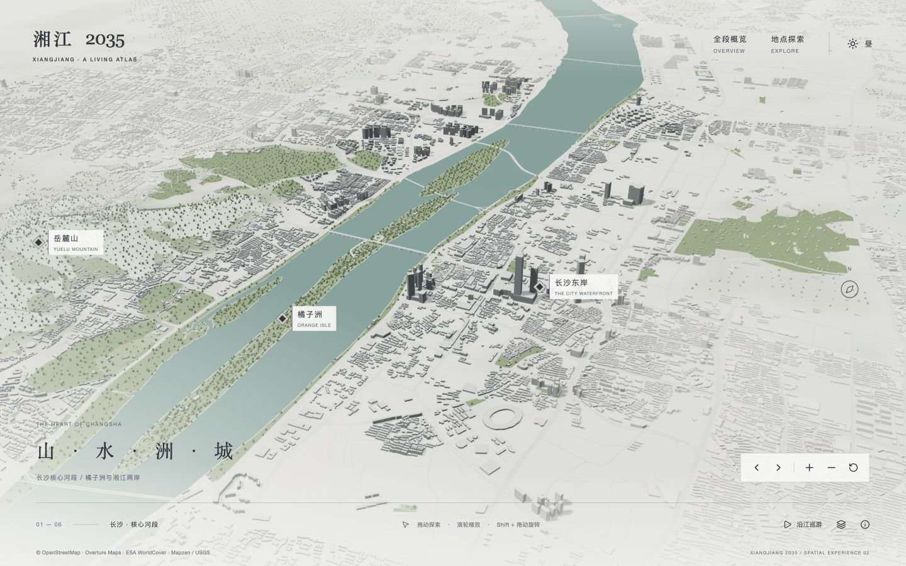
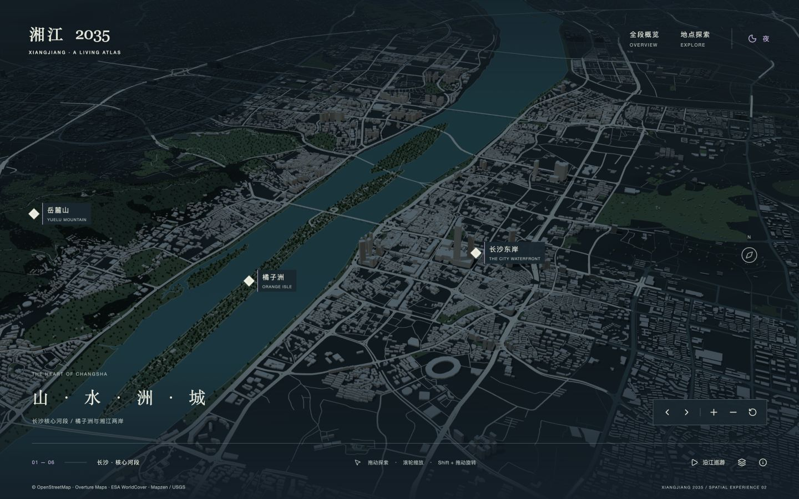
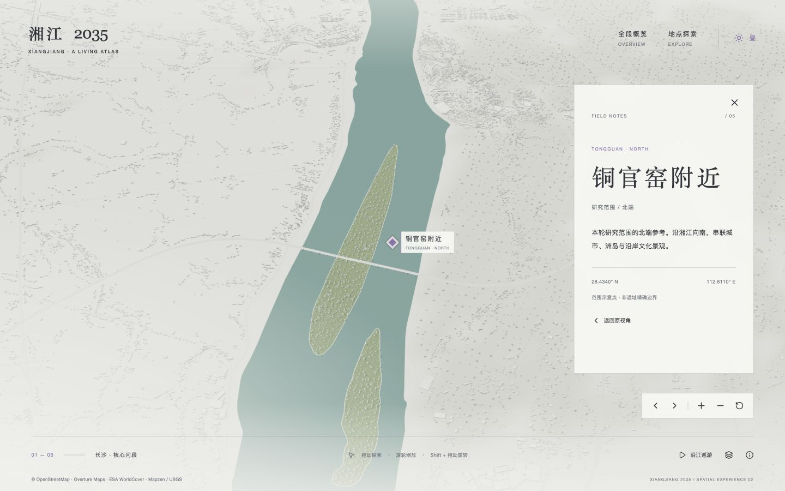
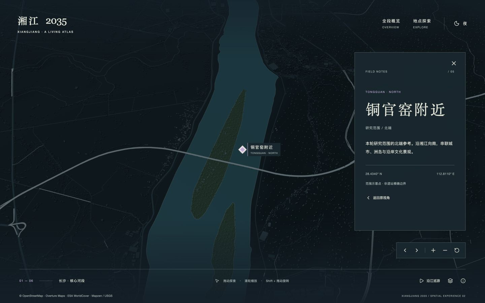
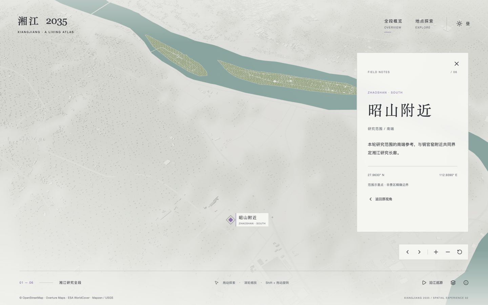
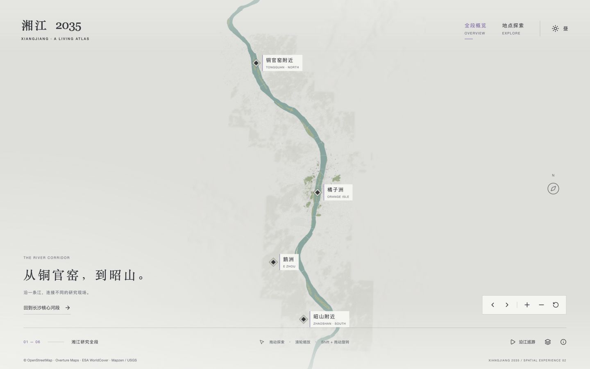
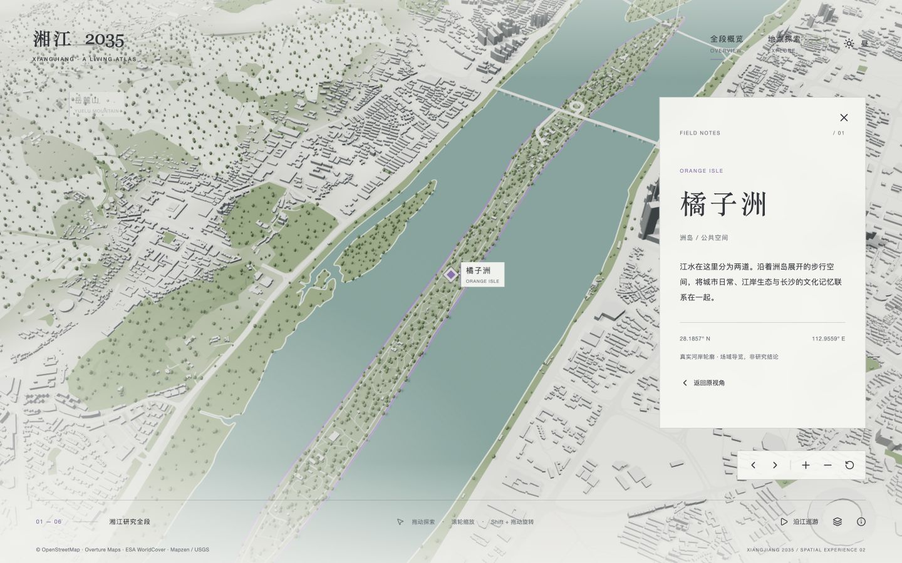
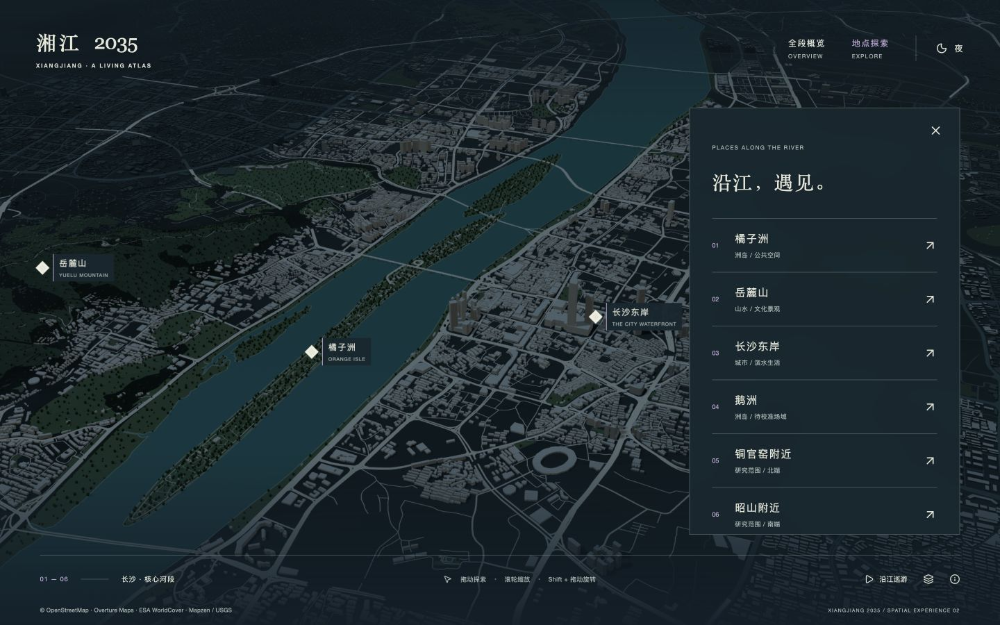

# 湘江 2035 与 Masar 再次视觉自查

日期：2026-10-22。状态：仅审计；等待用户确认后再修改产品。

## 结论

第二轮完成了地理覆盖补充，但尚未建立接近参考站的主体、背景和选中状态。当前整体更接近经过配色的地理白模；参考站则是有明确边界、材质、景观和灯光的重点项目，放置在低细节城市背景中。不能以建筑数量增加或功能可运行，认定视觉已对齐。

本次重新打开 [Masar 实际体验](https://www.masardestination.com.sa/en/experience)，操作日夜切换、Destination Components 和 Total Project Area；本地检查核心区日夜、地点菜单、铜官窑日夜、昭山、全段概览及橘子洲选中。主要对照截图均为1440×900，实际场景、地理尺度和摄影角度不同，因此用于比较视觉层次和界面体系，不是逐像素复刻评分。所有下列证据均为本轮新捕获，不沿用上轮截图。

## 步骤与健康度

| 步骤 | 检查范围 | 判断 |
|---|---|---|
| 1 | 日间默认场景 | 河道可辨，但灰白覆盖过重，重点带不成整体；未达标 |
| 2 | 夜间默认场景 | 切换可用，灯光主体缺失，道路线条抢眼；未达标 |
| 3 | 铜官窑、昭山局部 | 模型存在，沿江主体规则没有延伸到南北段；未达标 |
| 4 | 全段概览 | 可导航，但背景过淡且可见块状过渡；需修正 |
| 5 | 区域选中 | 镜头与标记能响应，场景区域强调不足；部分达标 |
| 6 | 菜单、面板、导航与动效衔接 | 功能有基础，视觉组织与参考明显不同；需重构 |

## 主要发现

### 1. 日间偏暖、发灰，根因是整套光照与材质叠加（优先级 P0）

观察：本地大面积地面、建筑屋顶、远景和界面都处在相近的浅灰米白范围，像覆盖一层浅色膜。参考日间背景也含暖灰，不能把“纯冷白”当作它的全部特征；其重要差别是背景白模明亮，主体保留灰色立面、明暗分面、深色道路、铺装与绿化，互相拉开。

本地实现证据：`src/experience/materials.ts` 第4行的背景、地面、外围建筑，以及暖色太阳；`app/experience/experience.module.css` 的渐变覆盖和面板底色；`src/experience/engine.ts` 的环境光、太阳光、色调映射共同影响最终颜色。具体贡献比例未做隔离实验，因此不声称只改某一个色值就能解决。

建议：中性灰白背景、清晰的建筑侧面与屋顶、降低覆盖层对主体的漂白；允许景观和铺装有克制色彩。先定明暗层次，再调色相。

### 2. 核心段之外没有执行同一条沿江强调规则（P0，已定位）

观察：北段、南段即使聚焦，沿岸建筑仍几乎溶于白色地面；夜间退成细小暗点。这并非模型仍未下载。

代码证据：`src/experience/terrain.ts:21` 的 importance 既乘距河衰减，也乘核心纬度附近的纵向衰减；`src/experience/materials.ts:10` 的新增背景建筑使用另一套材质，默认只有 context 色，点选时以地点为圆心做局部65%混色。新增建筑没有默认使用全段距河强调，也没有核心建筑的窗格/夜间发光处理。视觉层级被数据来源和核心地段绑住了。

建议：按“与河道、岸线、研究范围的关系”统一划分主体带与外围，覆盖铜官窑至昭山；局部聚焦另设选中状态。保留乡村与城市真实密度差异，不为追求亮度伪造连续高楼。

### 3. 常态主体强调与点击选中没有分成两套明确状态（P0）

参考：日间重点项目具有完整材质，外围白模；夜间重点项目仍明亮，外围压暗；进入区域说明后，目标建筑整体变成紫色强调并改变构图。

本地：常态主要是建筑灰度变化；橘子洲选中主要是淡紫描边，地面填色不明显；其他位置主要是标记变紫和小范围加深。周围场景没有同步降低权重。用户能看见一个地点标记，但难以读出整个被选区域。

建议：分清常态沿江主体、背景城市、当前选择三层。选中反馈作用于可解释的地点范围，协调模型/地面/边界与非选中区域，避免对所有对象仅加同一种描边。参考的紫色分析视图不能直接当作日常全段配色。

### 4. 夜景缺少光源层次，亮的是路网（P0）

观察：参考夜景保留明亮立面、窗光、地面铺装与景观，外围为深青色低细节体量。本地道路和楼顶的冷灰线条反而最显眼，窗光在默认尺度下很弱，南北段没有同等灯光表现。

本地实现不是简单CSS黑滤镜，但从成像效果看仍接近整体压暗。原因包括外围材质无夜间发光分支、核心窗格在远景下衰减，以及路网和建筑照明权重不平衡。

建议：先建立冷暗背景与有克制暖光的主体带，再设计桥梁、岸线和局部建筑亮点；同时降低非重点道路存在感。不能只统一提高曝光，否则外围也会一起亮。

### 5. UI 借用了极简元素，却没有复现空间组织（P1）

参考：左上品牌、右上返回；左下日夜双状态开关与位置示意；右下两个清晰的主要入口；几何按钮、细线、字距形成一致体系。组件菜单是与三维构图同步变化的屏幕布局，而不是孤立卡片。

本地：右上导航、右下五键工具条、底部工具、左下文案和多个矩形地点标签同时存在。入口分散、标签常驻，字体以中文衬线大标题为主，气质偏编辑式地图。右侧不透明大面板遮挡场景，不能仅通过调透明度和圆角补齐差距。

建议：明确主入口、辅助控制和地点状态的分组，压缩常驻信息，统一按钮与标记的几何语言；地点内容与相机留白一起设计。保留中文可读性与必要数据署名，不照搬英文小字号，也不复制Masar商标。

### 6. 模型质量仍是明显瓶颈（P1）

观察：本地大量低矮、同质的建筑在当前尺度下形成颗粒或平面线条；参考主体的屋顶、塔楼、立面分格、地标和地面组织共同提供识别度。新增数量主要解决连续性，没有等量提升美术质量。

代码可确认：外围为轮廓推导的包围体，未知高度默认值。建议保留外圈简模，把主河岸普通建筑的体量分类、屋顶/立面差异和少量真实地标优先做好；不能再靠全局拔高建筑模拟参考城市。

### 7. 地面、水岸和树木尚未组成有设计感的场景（P1）

观察：本地水面大尺度近似均匀青色面；绿地常呈绿色多边形，树木有均匀散点感，桥梁主要读成横跨水面的细线。参考的主区域有可读的铺装、道路边界和景观组织。湘江水面占屏比例更大，因此它的缺乏层次会被放大。

建议：保留真实河道，完善岸线深浅、克制的水面光照变化、桥梁体量及公园/林地差异。不要照搬参考站陆地项目的铺装色覆盖湘江。

### 8. 全段概览的过渡仍不自然（P1）

观察：全段图的背景几乎消失，但仍可见若干矩形/块状密度过渡。没有重新出现上轮水面深度闪斑，但“无闪斑”不等于边界已自然。

块状过渡的具体来源本轮未逐项隔离，不能直接归因为某一张瓦片。建议后续分别检查数据覆盖边缘、地形/林地栅格和材质衰减，按相邻尺度验证，不能继续加雾掩盖。

### 9. 镜头、信息面板和模式文字没有完全同步（P1）

观察：地点面板在飞行开始时即出现；昭山画面中心留出大片弱化地面，主体空间仍然不强；从核心进入铜官窑时底栏继续写“长沙·核心河段”，从全段进入橘子洲时又继续写“湘江研究全段”。这说明文字反映的是进入路径，不是当前观看地点。

代码可确认 focus() 立即 setSelected()，面板不依据 moving 状态编排；overview 状态也不随地点聚焦更新。建议按进入、飞行、到达、返回分配界面节奏，设计每个地点与面板共存时的构图，而非只将坐标移到画面中心。

### 10. 可读性风险应单独验收（P2）

英文副标题、底部说明、数据署名很小，浅色文字叠加繁密地图时有阅读风险；选中状态过度依赖浅紫颜色。菜单打开时，原地点面板仍在辅助功能树中，可能造成阅读顺序混乱。参考站自身也有小字和低对比菜单，不能照单全收。

建议保持明确焦点、可见选中标识、足够点击区域和中文阅读字号。此次没有完成屏幕阅读器、真机、全键盘流程或WCAG对比度量化测试，不作合规判断。

## 建议的修改边界（待确认）

先统一全段主体/外围/选中三层规则，并共同校正日夜光照、地面和建筑材质；随后重做UI分组与镜头配合，再推进模型、岸线和桥梁细节。每阶段按核心/北段/南段/全段、昼夜和选中状态成组对照，不能只展示最好看的核心区。

本轮不改产品代码、色值、数据或相机参数，不提交产品修改。

## 本轮截图证据

### 步骤1：日间对照

参考：

本地：

### 步骤2：夜间对照

参考：

本地：

### 步骤3：南北段

### 步骤4：全段

### 步骤5：选中反馈

参考的分析视图与本地地点聚焦用途不完全相同；这里比较区域强调与背景降权，而不主张复制其全部功能。

### 步骤6：UI组织

参考的常态入口见步骤1、2，组件菜单见步骤5；本地菜单如下。

## 证据限制

本次真实操作了参考站，但没有读取或复制其私有模型、贴图或着色器。关于参考效果的判断来自可见成像；其渲染实现不能仅凭截图确定。参考加载时的过渡图不作为稳定首屏证据，未对开场完整时序、声音、触屏与全部相机边界重新验收。动画时序建议依据可见变化及本地代码，不声称测得参考站的精确缓动参数。性能与数据库测试不是本轮视觉审计范围。
