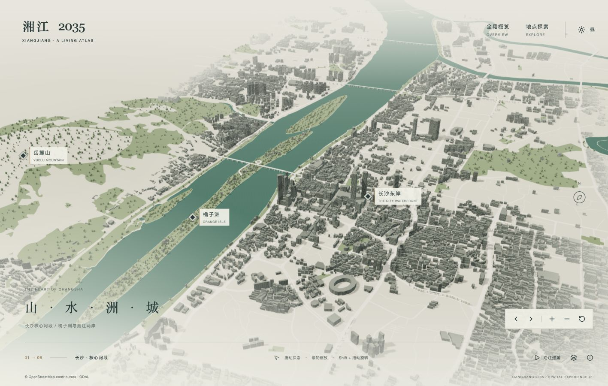
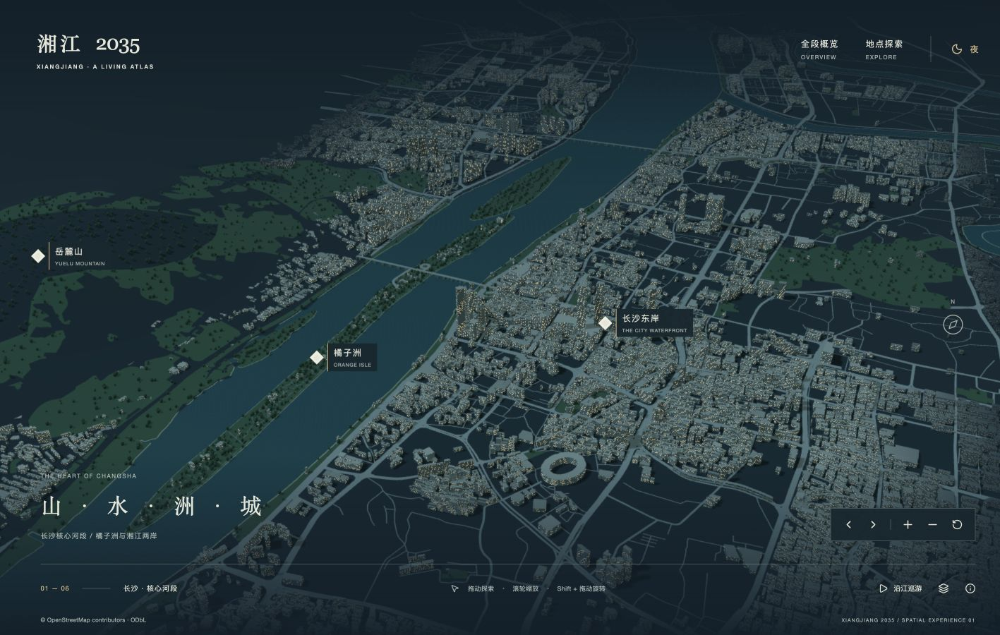
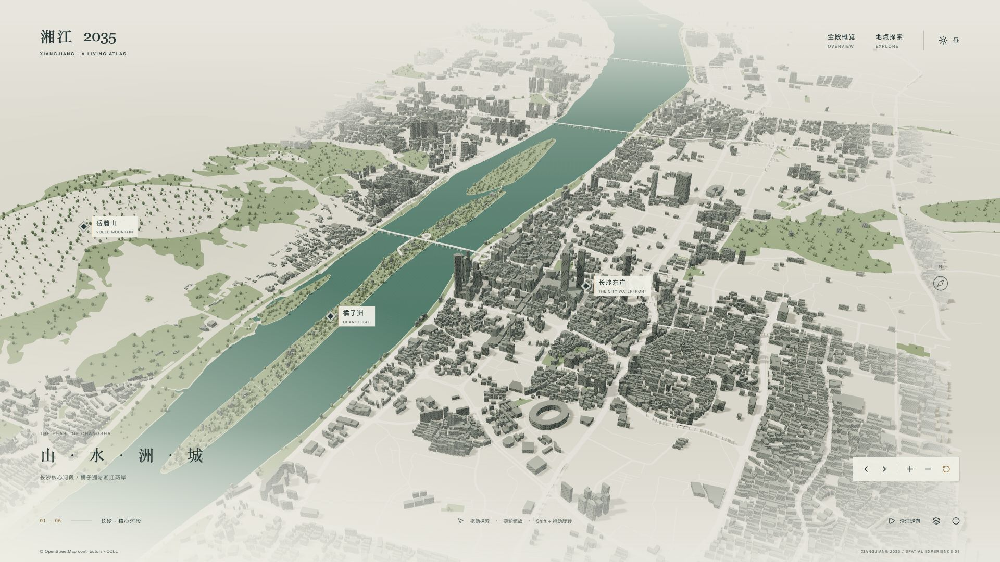
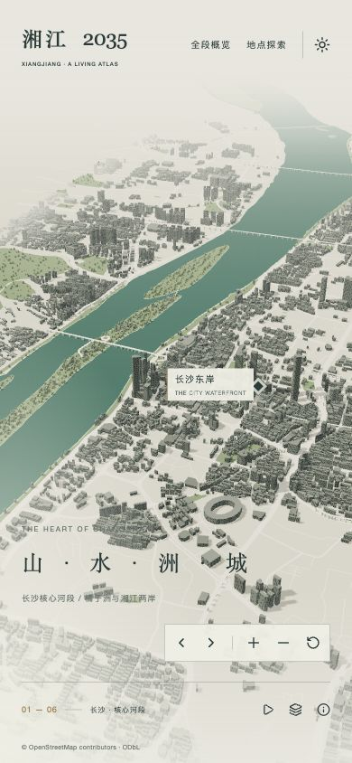
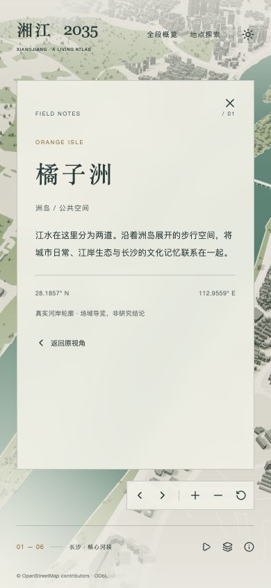
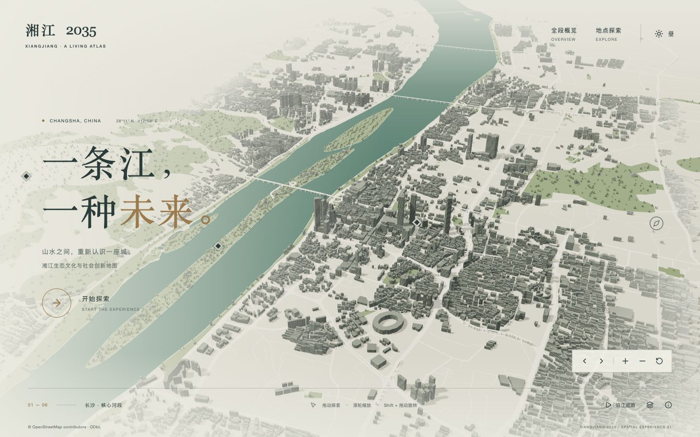

# 实际浏览器视觉对照与修正

本轮在 Codex 内置浏览器实际操作；1440×900 为主要对照视口，DOM 校验尺寸。截图工具导出的部分文件宽度为 1417px，保留原图，不拉伸伪装为标准尺寸。参考截图只供内部研究。

## 同尺寸日间对照

| Masar 实际日间 | 湘江日间 |
|---|---|
|  |  |

- 构图：参考以开发项目主轴和高层群为主角；湘江以真实河道和橘子洲为主轴，视野覆盖更宽的城市范围。同一视口下建筑更小，不能以截图相似度替代真实空间关系。
- 模型：参考有退台、塔楼、地标、铺地、路缘等定制资产；当前为真实建筑占地挤出，程序化立面，普通桥面与桥墩。微观细节及标志性天际线仍有明显差距。
- 材质与光照：采用石灰灰绿城市、克制水纹、暖色日光与阴影。初版过浅，后续提高核心建筑对比并修正朝下的道路三角面。水面保留微小法线变化；没有真实环境反射或岸边反射，不把高光称作完整反射系统。
- 边界：使用建筑空间渐淡、真实体量远景层及动态距离雾。默认与旋转视点无矩形底座；OSM 覆盖空缺、山体与城市衔接仍偏简化，不能称为连续完整长沙城市资产。
- UI：开放式文字、细线、少量导航和空间 marker；避免 Dashboard 面板。主要信息覆盖控制在周边；地点标签在画面边缘反向排布。

## 夜间对照

| Masar 夜间 | 湘江夜间 |
|---|---|
|  |  |

第一次夜景太暗，已提高环境光、建筑与地面可见性。最终夜间改变天空/雾、地面、建筑、窗光、江水与主光，而非覆盖黑色滤镜。仍缺少精细路灯、真实地标照明和局部光照设计；高频窗格远处有细小闪烁/混叠，可继续优化。

## 修正过程

1. `01-scene-first`：原首屏过高、水纹重复明显。
2. `02-intro-refined` / `03-intro-1440`：降低默认视点，减弱水纹，修正山体裙边进入河道和桥面背面朝上。
3. `05-camera-city` / `06-camera-island`：实际检查三组候选，选沿江纵深为默认，保留隔江望城/洲岛全貌。
4. `07-core-night`：早期夜景过暗，作为过程记录，不作最终夜景。
5. `09-final-intro-1440` / `10-final-day-1440` / `11-final-night-1440`：构图、对比、标签的第二轮检查。
6. `12-overview-night`：发现不完整支流被错误闭合，不作为最终验收图。
7. `13-overview-corrected`：源数据完整性检查后移除错误支流；主河道保持完整。
8. `14-place-day`：橘子洲实际定位、聚焦与信息面板。
9. `15-rotated-boundary`：旋转时发现焦点触发内部滚动，顶部被裁切；已将外容器改为 overflow:clip 并避免程序化焦点滚动，最终复测另存新图。

## 当前品质判断

已是可以运行和演示的真实三维湘江原型，河道、洲岛、城市体量和镜头行为可识别。当前还没有达到 Masar 的定制模型与美术完成度，尤其是地标、沿岸铺装、植被层次、全段沿岸覆盖与真实地形。继续提升应优先投入这些资产与数据，而不是扩展数据库功能。

## 最终桌面与移动尺寸

- `16-drag-zoom.jpg`：实际拖动和滚轮后的局部镜头，河道和建筑仍连续，导航位置正常。
- `17-rotation-fixed.jpg`：地点聚焦 → 关闭 → 旋转复测，DOM 确认 main.scrollTop=0、header.top=0，消除内部滚动裁切。
- `18-desktop-1920-full.jpg`：DOM 1920×1080，使用 fullPage 截图捕获完整画面。普通 `18-desktop-1920.jpg` 被宿主显示区域截断，不作完整布局证据。
- `19-mobile-core.jpg`：DOM 390×844，导航、相机按钮与署名在屏内；窄屏默认视野中橘子洲 marker 可能在侧边外，仍可通过地点列表进入。
- `20-mobile-place.jpg`：窄屏地点列表选择橘子洲成功，信息面板与返回入口可用；测试采用桌面浏览器窄视口，不冒充真机触摸验证。

| 移动场景 | 移动地点 |
|---|---|
|  |  |

正式品质仍需 Safari、真实触屏设备、WebGL 丢失/恢复和长时间压力测试。未实际触发的分支只算已实现，不能算已验收。

最终开场：`21-delivery-intro-1440.jpg`（1440×900 fullPage 截图，数据修正与焦点滚动修复后的生产构建）。

